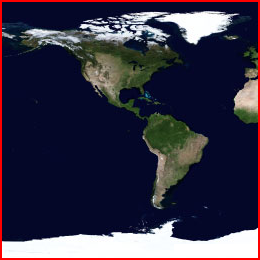
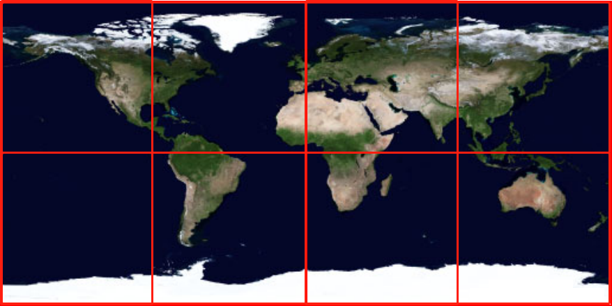
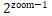
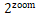
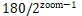
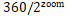
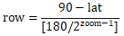
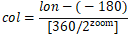

# tile-processor

将 TIFF 文件切割生成地图瓦片。

## 背景

本程序基于实际项目上的一个需求，要求将无人机航拍的正射图加载到地图上，这就需要把正射图切割成地图瓦片。

通常无人机配套的航拍数据处理软件上，自带有生成二维地图切片的功能，但该地图切片只能使用 Web Mercator 投影方式进行切片，只适用于 WGS84 、GCJ02 、 BD09 等坐标系。由于项目上使用的是 CGCS2000 坐标系的天地图，且市面上没有现成的工具，故需要自研切片程序，以满足实际项目需求。

## 说明

目前程序未做不同坐标系之间的相互转换，所以需要 `.tif` 文件需要使用 CGCS2000 坐标系。

无人机航拍数据处理软件导出文件时，有坐标系相关的选项，选择 CGCS2000 坐标系即可。如果已经导出了其他坐标系的正射图，比如默认导出的是 WGS84 坐标系的正射图，可以通过 GIS 处理软件进行坐标系转换，将其转换为 CGCS2000 坐标系的正射图即可。

## 使用

```PowerShell
# python tile_processor.py source_file zoom1,zoom2,zoom3

PS E:\Workspace\Codes> python.exe .\tile_processor.py .\result_test.tif 17,18
```

## 原理

### CGCS2000 坐标系天地图切片规则

CGCS2000 坐标系的天地图元数据获取地址为：https://t0.tianditu.gov.cn/img_c/wmts?request=GetCapabilities&service=wmts ，里面记录了天地图服务的相关信息级数据参数。

`TileMatrixSet` 标签下记录了支持的参考坐标系、各层级比例尺、瓦片尺寸、各层级下的瓦片行（ TileMatrixSet ）列（ MatrixWidth ）数等。

以下为一级下的参数：
```xml
<TileMatrixSet>
  <ows:Identifier>c</ows:Identifier>
  <ows:SupportedCRS>urn:ogc:def:crs:EPSG::4490</ows:SupportedCRS>
  <TileMatrix>
    <ows:Identifier>1</ows:Identifier>
    <ScaleDenominator>2.958293554545656E8</ScaleDenominator>
    <TopLeftCorner>90.0 -180.0</TopLeftCorner>
    <TileWidth>256</TileWidth>
    <TileHeight>256</TileHeight>
    <MatrixWidth>2</MatrixWidth>
    <MatrixHeight>1</MatrixHeight>
  </TileMatrix>
  ...
</TileMatrixSet>
```
通过 `TileMatrix` 标签我们可以知道，第一级共 1 行、2 列，2 张瓦片（沿着本初子午线将世界地图一份为二，共 1 行、2 列），对应的瓦片如下图所示：



左边瓦片地址为：https://t2.tianditu.gov.cn/img_c/wmts?SERVICE=WMTS&REQUEST=GetTile&VERSION=1.0.0&LAYER=img&STYLE=default&TILEMATRIXSET=c&FORMAT=tiles&TILECOL=0&TILEROW=0&TILEMATRIX=1&tk=68d166cfe304fa077ff035bed00edc37

右边瓦片地址为：https://t2.tianditu.gov.cn/img_c/wmts?SERVICE=WMTS&REQUEST=GetTile&VERSION=1.0.0&LAYER=img&STYLE=default&TILEMATRIXSET=c&FORMAT=tiles&TILECOL=1&TILEROW=0&TILEMATRIX=1&tk=68d166cfe304fa077ff035bed00edc37

第一级瓦片的行列号分别为 `TILECOL=0&TILEROW=0` 和 `TILECOL=1&TILEROW=0` ，由此可知，行号是从 0 开始的，列号也是从 0 开始。

第二级共 2 行、4 列，8张瓦片：



……

由以上切片规则，我们能够知道，当地图层级为 zoom 时，共有  、 列。

此时，每一行（ Row ）的纬度跨度为  ，每一列（ Col ）的跨度为  。

假设现在有某一位置所在的经度为 lon ，纬度为 lat ，则在第 zoom 级时，该位置所在瓦片的行号为  ，列号为  。显然，这两个行、列号不一定都是整数，而地图瓦片的行列号肯定都是整数；由于行、列号都是从 0 开始的，所以可以对这两个计算公式的结果向上取整，然后再减 `1` ，这样得到的结果便是该位置所在瓦片的行、列号。

### 偏移量计算

影像图的顶点（左上角位置）一般无法正好与瓦片顶点重合，所以在切割时，需要计算顶点偏移。

首先计算出顶点所在的瓦片行、列号，根据行、列号可以计算出瓦片顶点的经、纬度值。

然后根据影像图顶点的经、纬度值和瓦片顶点的经、纬度值即可计算出影像图的偏移量。
